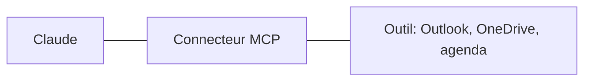

# 13 - Bonus, les connecteurs et MCP

---
## 13. Bonus: les connecteurs et MCP
Brancher l'IA sur vos outils.

---
## MCP, une prise standard
- MCP (Model Context Protocol) est **une prise standard** entre une IA et un outil, comme une prise USB
- Un **connecteur** est un serveur MCP: il donne à l'IA un accès à un outil (agenda, mails, fichiers, une application)
- Le même standard fonctionne avec Claude, ChatGPT et d'autres IA
- Sans connecteur, l'IA ne voit que ce que vous lui donnez

---
## Ce qu'un connecteur permet
- **Lire**: vos mails, votre agenda, vos fichiers en ligne
- **Chercher**: "Retrouve le dernier mail de l'inspection sur le CEB"{copy}
- **Agir**: créer un rendez-vous, préparer un brouillon de mail, ajouter une ligne dans un tableau
- Exemples pour l'école: Microsoft 365 (Outlook, OneDrive, Teams), Google Drive, un agenda

---
## Ajouter un connecteur
- Dans les **paramètres** de l'application, rubrique des connecteurs
- Sur Entreprise, **l'admin** choisit les connecteurs permis pour le collège
- À la connexion, lisez **les autorisations demandées**: lecture seule, ou aussi écriture et envoi?
- Testez d'abord sur une demande simple: "Quels sont mes rendez-vous demain?"{copy}

Note: Les noms exacts des menus dépendent de la version de l'application: vérifier avant la séance 2.

---
## Les risques d'un connecteur
- Chaque connecteur est **une porte de plus** vers vos données
- **N'activez que ce qui sert**, et désactivez ce qui ne sert plus
- Préférez les connecteurs **officiels** ou de confiance
- Un connecteur qui peut **envoyer** (mail, formulaire) + des données privées + du contenu non fiable = **la triple menace** (partie 8)

---
## Connecteur, navigateur ou ordinateur?
1. **Le connecteur**: le plus rapide et le plus fiable. Le premier choix quand il existe
2. **Le navigateur** (Claude in Chrome): pour les sites sans connecteur
3. **L'ordinateur**: Claude clique à votre place. Le dernier recours: plus lent, à surveiller
