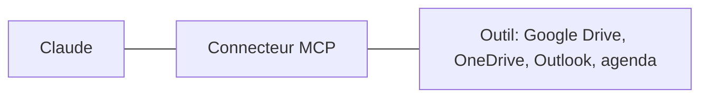

# 13 - Bonus, les connecteurs et MCP

---
## 13. Bonus: les connecteurs et MCP
Brancher Claude sur vos outils: Google Drive, Microsoft 365, votre agenda.

---
## Brancher Claude sur vos outils
- Un **connecteur** relie Claude à un service que vous utilisez déjà: vos documents en ligne, vos mails, votre agenda
- Claude peut alors **y chercher, y lire, et parfois y agir** pour vous
- Vous vous connectez avec **votre propre compte**: Claude ne voit que ce que vous pouvez déjà voir
- Sans connecteur, l'IA ne voit que ce que vous lui donnez
- Derrière, il y a **une prise standard**, MCP (Model Context Protocol), comme une prise USB. Le même standard fonctionne avec Claude, ChatGPT et d'autres IA

---
## Ce qu'un connecteur permet
- **Lire**: vos mails, votre agenda, vos fichiers en ligne
- **Chercher**: "Retrouve le dernier mail de l'inspection sur le CEB"{copy}
- **Agir**: créer un rendez-vous, préparer un brouillon de mail, ajouter une ligne dans un tableau
- Exemples pour l'école: Microsoft 365 (Outlook, OneDrive, Teams), Google Drive, un agenda

---
## Les connecteurs utiles pour une école
| Le service | Ce que Claude peut y faire |
|---|---|
| **Microsoft 365**: SharePoint, OneDrive, Outlook, Teams | Chercher et lire vos documents, vos mails, vos réunions. Écrire, envoyer ou planifier: **seulement si l'admin l'a permis** |
| **Google Drive** | Chercher dans votre Drive, lire des Docs, des Sheets, des Slides, des PDF et des fichiers Office, et y créer des fichiers |
| **Gmail** | Chercher dans vos mails, et répondre à vos questions en citant le mail d'origine |
| **Google Agenda** | Vos réunions, les participants, vos disponibilités |

Pour utiliser un fichier précis de Google Drive dans une conversation: le bouton **"+"**, puis l'ajout depuis Google Drive.

Documentation: [Google Drive (en anglais)](https://claude.com/docs/connectors/google/drive) · [Microsoft 365 (en anglais)](https://claude.com/docs/connectors/microsoft/365)

Note: Lu le 13/11/2026 dans la documentation de Claude. Google Drive: le connecteur est fait par Google. Deux limites: un très gros fichier peut arriver incomplet, et Claude ne lit pas les commentaires ni les suggestions d'un document. Dans le menu "+", le choix s'appelle "Add from Google Drive" dans la version en anglais. Microsoft 365: sur Team et Entreprise, seulement les comptes professionnels ou scolaires. Tout se fait avec les droits de la personne: Claude ne lit et ne change que ce que son compte peut déjà lire et changer. Les actions d'écriture (envoyer un mail, créer un rendez-vous, modifier un fichier, écrire dans Teams) sont réglées par les administrateurs. À ne pas confondre avec "Claude for Microsoft 365", les compléments qui mettent Claude dans Word, Excel, PowerPoint et Outlook: bonus 16.

---
## Ajouter un connecteur
1. D'abord **l'admin**: il ajoute le connecteur pour le collège. Tant que ce n'est pas fait, vous voyez un bouton pour **le demander**, à la place du bouton de connexion
2. Vous: **Personnaliser > Connecteurs**. Parcourez l'annuaire, et choisissez le service (par exemple Microsoft 365 ou Google Drive)
3. Cliquez sur **"Connecter"**, et connectez-vous au service avec **votre compte du collège**
4. Lisez **les autorisations demandées**: lecture seule, ou aussi écriture et envoi?
5. Dans une conversation: **"+"**, puis **"Connecteurs"**, et activez le service pour cette conversation
6. Testez sur une demande simple: "Quels sont mes rendez-vous demain?"{copy}

Documentation: [Utiliser les connecteurs](https://support.claude.com/fr/articles/11176164) · [Configurer le connecteur Microsoft 365](https://support.claude.com/fr/articles/12542951) · [Get started with connectors (en anglais)](https://claude.com/docs/connectors/getting-started)

Note: Étapes lues le 13/11/2026 dans le centre d'aide en français et dans la documentation de Claude en anglais: à vérifier sur leur PC avant la séance 2. Dans la version en anglais: "Customize > Connectors", l'onglet "Discover" pour l'annuaire, le bouton "Connect to Claude", et "Request" quand le connecteur n'est pas encore ajouté pour l'organisation. Quand la connexion a réussi, le connecteur est dans "Your connectors", avec l'état "Connected". Côté admin (propriétaire de l'organisation): "Paramètres de l'organisation > Connecteurs", choisir le service, et "Ajouter à votre équipe". Pour Microsoft 365, un administrateur général du collège (Microsoft Entra) doit aussi donner son accord une fois. Ajouter un connecteur pour le collège ne donne pas l'accès: chaque personne se connecte elle-même, avec son compte.

---
## Garder la main sur un connecteur
- Un connecteur connecté **n'est pas actif partout**: vous l'activez conversation par conversation, dans le menu **"+"**
- Avant d'utiliser un outil du connecteur, Claude **demande votre accord**: pour une fois, ou pour toujours. Au début, choisissez **une fois**
- Pour chaque outil d'un connecteur, vous choisissez: toujours permis, **accord demandé**, ou **bloqué**
- **Déconnecter** un connecteur: Claude n'a plus accès au service. Vous pouvez vous reconnecter plus tard

Note: Dans la version en anglais: "Allow once" et "Always allow" au moment de l'accord. Sur la page du connecteur ("Customize > Connectors", puis le connecteur sous "Your connectors"): "Tool permissions", avec "Always allow", "Needs approval" ou "Blocked", et les boutons "Disconnect" et "Remove". Conseil pour une école: bloquer les outils qui envoient (mail, message Teams) tant qu'on n'en a pas besoin.

---
## Les risques d'un connecteur
- Chaque connecteur est **une porte de plus** vers vos données
- **N'activez que ce qui sert**, et désactivez ce qui ne sert plus
- Préférez les connecteurs **officiels** ou de confiance
- Un connecteur qui peut **envoyer** (mail, formulaire) + des données privées + du contenu non fiable = **la triple menace** (partie 8)

---
## Connecteur, navigateur ou ordinateur?
1. **Le connecteur**: le plus rapide et le plus fiable. Le premier choix quand il existe
2. **Le navigateur** (Claude in Chrome): pour les sites sans connecteur
3. **L'ordinateur**: Claude clique à votre place. Le dernier recours: plus lent, à surveiller, et pas encore sur l'abonnement Entreprise
