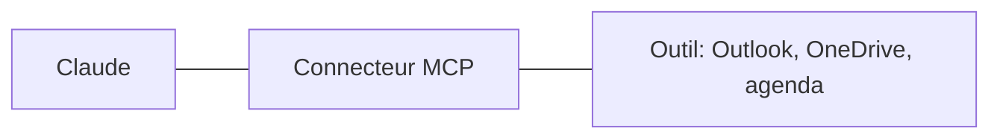

# 13 - Bonus, les connecteurs et MCP

---
## 13. Bonus: les connecteurs et MCP
Brancher l'IA sur vos outils.

---
## MCP, une prise standard
- MCP (Model Context Protocol) est **une prise standard** entre une IA et un outil, comme une prise USB
- Un **connecteur** est un serveur MCP: il donne à l'IA un accès à un outil (agenda, mails, fichiers, une application)
- Le même standard fonctionne avec Claude, ChatGPT et d'autres IA
- Sans connecteur, l'IA ne voit que ce que vous lui donnez

---
## Ce qu'un connecteur permet
- **Lire**: vos mails, votre agenda, vos fichiers en ligne
- **Chercher**: "Retrouve le dernier mail de l'inspection sur le CEB"{copy}
- **Agir**: créer un rendez-vous, préparer un brouillon de mail, ajouter une ligne dans un tableau
- Exemples pour l'école: Microsoft 365 (Outlook, OneDrive, Teams), Google Drive, un agenda

---
## Ajouter un connecteur
1. D'abord **l'admin**: il ajoute le connecteur pour le collège, dans les paramètres de l'organisation
2. Vous: **Personnaliser > Connecteurs**. Trouvez le service (par exemple Microsoft 365), et cliquez sur **"Connecter"**
3. Choisissez **"Compte professionnel ou scolaire"**, et connectez-vous avec votre compte du collège
4. Lisez **les autorisations demandées**: lecture seule, ou aussi écriture et envoi?
5. Dans une conversation: **"+"** ou **"/"**, puis "Connecteurs", et activez le service
6. Testez sur une demande simple: "Quels sont mes rendez-vous demain?"{copy}

Documentation: [Utiliser les connecteurs](https://support.claude.com/fr/articles/11176164) · [Configurer le connecteur Microsoft 365](https://support.claude.com/fr/articles/12542951)

Note: Étapes lues le 13/11/2026 dans le centre d'aide, en français: à vérifier sur leur PC avant la séance 2. Côté admin (propriétaire de l'organisation): "Paramètres de l'organisation > Connecteurs", puis "Parcourir les connecteurs", choisir Microsoft 365, et "Ajouter à votre équipe". Pour Microsoft 365, un administrateur général du collège (Microsoft Entra) doit aussi donner son accord une fois. Ajouter un connecteur pour le collège ne donne pas l'accès: chaque personne se connecte elle-même. Sur Entreprise, un membre ne peut demander un connecteur que si un propriétaire a activé cette possibilité.

---
## Les risques d'un connecteur
- Chaque connecteur est **une porte de plus** vers vos données
- **N'activez que ce qui sert**, et désactivez ce qui ne sert plus
- Préférez les connecteurs **officiels** ou de confiance
- Un connecteur qui peut **envoyer** (mail, formulaire) + des données privées + du contenu non fiable = **la triple menace** (partie 8)

---
## Connecteur, navigateur ou ordinateur?
1. **Le connecteur**: le plus rapide et le plus fiable. Le premier choix quand il existe
2. **Le navigateur** (Claude in Chrome): pour les sites sans connecteur
3. **L'ordinateur**: Claude clique à votre place. Le dernier recours: plus lent, à surveiller, et pas encore sur l'abonnement Entreprise
