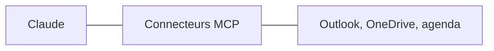

# 4 - IA générative et IA agentique

---
## 4. Comprendre ce qu'on vient de voir
L'IA générative: une IA qui **crée du contenu** (texte, image, son, vidéo, code), au lieu de seulement classer des données.

---
## De la demande à la réponse

<svg viewBox="0 0 960 300" xmlns="http://www.w3.org/2000/svg" role="img" aria-label="Schéma: la demande passe par le fournisseur, puis par le modèle, qui génère la réponse">
<text x="110" y="30" font-size="15" fill="#ff4fa8" font-weight="700" text-anchor="middle">LA DEMANDE</text>
<text x="350" y="30" font-size="15" fill="#ff4fa8" font-weight="700" text-anchor="middle">LE FOURNISSEUR</text>
<text x="590" y="30" font-size="15" fill="#ff4fa8" font-weight="700" text-anchor="middle">LE MODÈLE</text>
<text x="830" y="30" font-size="15" fill="#ff4fa8" font-weight="700" text-anchor="middle">LA RÉPONSE</text>
<rect x="20" y="46" width="180" height="104" rx="14" fill="#475363"/>
<text x="110" y="92" font-size="17" fill="#fff" font-weight="700" text-anchor="middle">« Écris un mot</text>
<text x="110" y="116" font-size="17" fill="#fff" font-weight="700" text-anchor="middle">aux parents »</text>
<text x="110" y="180" font-size="15" fill="rgba(255,255,255,0.74)" font-weight="400" text-anchor="middle">instructions + contexte</text>
<polygon points="0,0 12,0 26,16 12,32 0,32 14,16" transform="translate(212,82) scale(1.0)" fill="#e5007d"/>
<rect x="260" y="46" width="180" height="104" rx="14" fill="rgba(229,0,125,0.16)" stroke="#ff4fa8" stroke-width="3"/>
<text x="350" y="94" font-size="21" fill="#fff" font-weight="700" text-anchor="middle">Anthropic</text>
<text x="350" y="120" font-size="14" fill="rgba(255,255,255,0.74)" font-weight="400" text-anchor="middle">fait tourner le modèle</text>
<text x="350" y="180" font-size="15" fill="rgba(255,255,255,0.74)" font-weight="400" text-anchor="middle">compte · capacité</text>
<text x="350" y="200" font-size="15" fill="rgba(255,255,255,0.74)" font-weight="400" text-anchor="middle">facturation · sécurité</text>
<polygon points="0,0 12,0 26,16 12,32 0,32 14,16" transform="translate(452,82) scale(1.0)" fill="#e5007d"/>
<circle cx="590" cy="98" r="60" fill="#e5007d"/>
<text x="590" y="94" font-size="21" fill="#fff" font-weight="700" text-anchor="middle">Claude</text>
<text x="590" y="118" font-size="15" fill="#fff" font-weight="400" text-anchor="middle">(un LLM)</text>
<text x="590" y="180" font-size="15" fill="rgba(255,255,255,0.74)" font-weight="400" text-anchor="middle">des milliards de paramètres</text>
<text x="590" y="200" font-size="15" fill="#ff4fa8" font-weight="700" text-anchor="middle">statistique, pas déterministe</text>
<polygon points="0,0 12,0 26,16 12,32 0,32 14,16" transform="translate(664,82) scale(1.0)" fill="#e5007d"/>
<rect x="742" y="50" width="86" height="38" rx="8" fill="#475363"/>
<text x="785" y="75" font-size="16" fill="#fff" font-weight="700" text-anchor="middle">Texte</text>
<rect x="836" y="50" width="86" height="38" rx="8" fill="#475363"/>
<text x="879" y="75" font-size="16" fill="#fff" font-weight="700" text-anchor="middle">Image</text>
<rect x="742" y="98" width="86" height="38" rx="8" fill="#475363"/>
<text x="785" y="123" font-size="16" fill="#fff" font-weight="700" text-anchor="middle">Code</text>
<rect x="836" y="98" width="86" height="38" rx="8" fill="#475363"/>
<text x="879" y="123" font-size="16" fill="#fff" font-weight="700" text-anchor="middle">Vidéo</text>
<text x="830" y="180" font-size="15" fill="rgba(255,255,255,0.74)" font-weight="400" text-anchor="middle">le contenu généré</text>
<text x="20" y="252" font-size="14" fill="#ff4fa8" font-weight="700" text-anchor="start">TAILLE DES MODÈLES</text>
<line x1="250" y1="247" x2="900" y2="247" stroke="rgba(255,255,255,0.35)" stroke-width="3"/>
<circle cx="250" cy="247" r="5" fill="#a855f7"/>
<text x="250" y="288" font-size="14" fill="rgba(255,255,255,0.74)" font-weight="400" text-anchor="middle">1 milliard</text>
<circle cx="430" cy="247" r="8" fill="#a855f7"/>
<text x="430" y="288" font-size="14" fill="rgba(255,255,255,0.74)" font-weight="400" text-anchor="middle">8 milliards</text>
<circle cx="640" cy="247" r="11" fill="#a855f7"/>
<text x="640" y="288" font-size="14" fill="rgba(255,255,255,0.74)" font-weight="400" text-anchor="middle">200 milliards</text>
<circle cx="900" cy="247" r="15" fill="#a855f7"/>
<text x="930" y="288" font-size="14" fill="rgba(255,255,255,0.74)" font-weight="400" text-anchor="end">3 000 milliards de paramètres</text>
</svg>

- **Statistique, pas déterministe**: même demande, **deux réponses différentes**
- Plus de paramètres: plus de capacités, et **plus de coût**. Mais la taille ne fait pas tout

Note: À PASSER si le temps manque. Quatre idées en une image. La demande: vos instructions, plus le contexte. Le fournisseur: la société qui fait tourner le modèle (ici Anthropic); c'est par lui que passent votre compte, vos données et la facture. Le modèle: des milliards de paramètres, réglés pendant l'entraînement; il calcule la suite la plus probable, donc il ne donne pas deux fois exactement la même réponse. La réponse: du texte, mais aussi une image, du code, une vidéo. Les tailles sont des ordres de grandeur, d'un petit modèle qui tourne sur un PC aux plus gros modèles.

---
## Comment ça marche, sans maths
- Un LLM (grand modèle de langage) **prédit la suite la plus probable** d'un texte
- Il écrit morceau par morceau. Ces morceaux s'appellent des **tokens** (environ trois quarts d'un mot)
- Il a appris sur une énorme quantité de textes, jusqu'à une date limite
- Il ne "sait" rien de votre école, **sauf ce que vous lui donnez**

Note: ESSENTIEL.

---
## Le prompt
Le prompt, c'est la demande que vous écrivez: **une partie du contexte**, pas tout. La recette, en six points:

1. **Qui vous êtes**
2. **Ce que vous voulez**
3. **Pour qui**
4. **Sous quelle forme** (longueur, ton, liste ou texte)
5. **Un exemple**, si vous en avez un
6. **Les règles et les critères** d'un bon résultat

**Commencez simple**: ajoutez des consignes seulement si le résultat ne convient pas.

Note: ESSENTIEL. C'est la même recette partout dans le cours: ici, dans "votre vraie tâche" (partie 9), dans le bonus 11 et sur l'aide-mémoire. Pourquoi commencer simple: les modèles ont besoin de moins en moins d'aide (bonus 11).

---
## Deux astuces pour vos demandes
- Mettez **les informations et les règles importantes à la fin**: la fin d'un long texte est mieux lue que le milieu
- Demandez-lui de **vous poser des questions** avant de commencer: "Pose-moi les questions qui te manquent."{copy} Il propose souvent des choix à cliquer: c'est très rapide
- Les techniques de prompting (exemples, rôles, étapes, critères): **bonus 11**

Note: À PASSER si le temps manque.

---
## L'hallucination
- Claude prédit ce qui est probable, **pas ce qui est vrai**
- Il peut donc inventer un fait, une date, une source, avec aplomb
- C'est une **hallucination**
- Règle: les faits, les chiffres et les sources **se vérifient toujours**
- Demandez-lui de **citer la phrase exacte et la page** de chaque information: vous vérifiez en un coup d'œil
- Son **niveau de confiance** est un indice, **pas une preuve**: il peut être sûr de lui et se tromper

Une analogie: un stagiaire très cultivé, très rapide, qui ne vous connaît pas, et qui **n'ose jamais dire** "je ne sais pas".

Note: ESSENTIEL.

---
## La complaisance
- Claude a tendance à **vous donner raison**: il flatte, il évite de vous contredire
- Il a appris à plaire, pas à dire la vérité qui dérange
- Le risque: il valide une mauvaise idée, un calcul faux, une décision fragile
- La parade: demandez-lui de **critiquer**. "Qu'est-ce qui cloche dans ce plan?"{copy}, "Joue l'avocat du diable"{copy}, "Donne-moi les trois meilleures objections"{copy}

Note: ESSENTIEL. C'est le risque le plus utile à connaître pour une direction: on utilise Claude pour vérifier ses propres décisions, et il a tendance à les approuver. Le montrer en direct si le temps le permet: proposer une idée discutable, puis demander "Qu'est-ce qui cloche?".

---
## Points forts, points faibles
| Bon pour | Moins bon pour |
|---|---|
| Rédiger, reformuler | Les faits précis |
| Résumer, traduire | Les chiffres |
| Structurer, trier | Les sources |
| Trouver des idées | L'actualité, sans recherche web |

Attention: il peut être brillant sur une tâche et rater la tâche voisine. **Testez-le sur vos vraies tâches**, et plus d'une fois.

Note: À PASSER si le temps manque.

---
## Pas seulement du texte
- **Lire des images**: une photo d'une page écrite à la main, une capture d'écran, un tableau photographié deviennent du texte ou un tableau
- **Créer des visuels**: un schéma, une affiche simple, une infographie. Pour des images réalistes, d'autres outils existent (ChatGPT, Gemini)
- **Créer des animations et des vidéos courtes**, à partir d'un texte ou d'un tableau
- **Créer des petits jeux et des applications**: un quiz pour une classe, un jeu de calcul mental, un outil de tirage au sort, en quelques minutes

Note: À PASSER si le temps manque. Exemple à dire: "Crée un jeu de calcul mental pour des élèves de 2e primaire, avec un score." Claude le construit dans un artefact, et on peut y jouer tout de suite. Pour les animations: Claude Motion existe sur Team et Enterprise, mais il est désactivé par défaut sur Enterprise.

---
## L'IA agentique

<svg viewBox="0 0 960 306" xmlns="http://www.w3.org/2000/svg" role="img" aria-label="Schéma: le chat répond en une passe, l'agent recommence jusqu'à atteindre son objectif">
<text x="20" y="30" font-size="18" fill="#ff4fa8" font-weight="700" text-anchor="start">LE CHAT</text>
<text x="460" y="30" font-size="14" fill="rgba(255,255,255,0.74)" font-weight="400" text-anchor="end">une seule passe</text>
<line x1="480" y1="14" x2="480" y2="300" stroke="rgba(255,255,255,0.25)" stroke-width="2"/>
<circle cx="80" cy="136" r="52" fill="rgba(255,255,255,0.10)" stroke="rgba(255,255,255,0.7)" stroke-width="2"/>
<text x="80" y="142" font-size="16" fill="#fff" font-weight="700" text-anchor="middle">Demande</text>
<circle cx="235" cy="136" r="52" fill="#475363" stroke="rgba(255,255,255,0.7)" stroke-width="2"/>
<text x="235" y="142" font-size="16" fill="#fff" font-weight="700" text-anchor="middle">Modèle</text>
<circle cx="390" cy="136" r="52" fill="rgba(255,255,255,0.10)" stroke="rgba(255,255,255,0.7)" stroke-width="2"/>
<text x="390" y="142" font-size="16" fill="#fff" font-weight="700" text-anchor="middle">Réponse</text>
<polygon points="0,0 12,0 26,16 12,32 0,32 14,16" transform="translate(144,120) scale(1.0)" fill="rgba(255,255,255,0.7)"/>
<polygon points="0,0 12,0 26,16 12,32 0,32 14,16" transform="translate(299,120) scale(1.0)" fill="rgba(255,255,255,0.7)"/>
<text x="235" y="238" font-size="16" fill="#fff" font-weight="700" text-anchor="middle">L'échange finit quand</text>
<text x="235" y="260" font-size="16" fill="#fff" font-weight="700" text-anchor="middle">la réponse arrive.</text>
<text x="500" y="30" font-size="18" fill="#ff4fa8" font-weight="700" text-anchor="start">L'AGENT</text>
<text x="940" y="30" font-size="14" fill="rgba(255,255,255,0.74)" font-weight="400" text-anchor="end">il recommence jusqu'au but</text>
<text x="720" y="60" font-size="15" fill="#ff4fa8" font-weight="700" text-anchor="middle">Un objectif</text>
<circle cx="720" cy="126" r="54" fill="#e5007d"/>
<text x="720" y="122" font-size="16" fill="#fff" font-weight="700" text-anchor="middle">L'application</text>
<text x="720" y="144" font-size="14" fill="#fff" font-weight="400" text-anchor="middle">Claude</text>
<text x="590" y="132" font-size="16" fill="#fff" font-weight="700" text-anchor="middle">Le modèle</text>
<line x1="640" y1="126" x2="664" y2="126" stroke="rgba(255,255,255,0.5)" stroke-width="2"/>
<text x="852" y="132" font-size="16" fill="#fff" font-weight="700" text-anchor="middle">Le contexte</text>
<line x1="776" y1="126" x2="800" y2="126" stroke="rgba(255,255,255,0.5)" stroke-width="2"/>
<text x="590" y="232" font-size="18" fill="#ff4fa8" font-weight="700" text-anchor="middle">Réfléchir</text>
<polygon points="0,0 12,0 26,16 12,32 0,32 14,16" transform="translate(646,210) scale(1.0)" fill="#e5007d"/>
<text x="720" y="232" font-size="18" fill="#ff4fa8" font-weight="700" text-anchor="middle">Agir</text>
<polygon points="0,0 12,0 26,16 12,32 0,32 14,16" transform="translate(764,210) scale(1.0)" fill="#e5007d"/>
<text x="852" y="232" font-size="18" fill="#ff4fa8" font-weight="700" text-anchor="middle">Observer</text>
<text x="720" y="264" font-size="15" fill="#ff4fa8" font-weight="400" text-anchor="middle">↺ la boucle de l'agent</text>
<text x="720" y="294" font-size="15" fill="#fff" font-weight="700" text-anchor="middle">fichiers · web · applications · connecteurs</text>
</svg>

Un chatbot répond. Un agent **agit**: une application + un modèle + des instructions + des outils + des permissions + du contexte.

Note: ESSENTIEL.

---
## Tout ce que vous faites sur votre PC, Claude peut le faire
Ce que vous pouvez faire sur votre ordinateur, dans le navigateur ou sur le réseau, un agent peut le faire aussi. **Avec votre accord.**

- **Fichiers**: lire, écrire, renommer, ranger un dossier entier
- **Documents**: créer des Word, des Excel, des PDF, des présentations
- **Web**: ouvrir des pages, les lire, chercher, remplir un formulaire
- **Messages**: préparer et envoyer des mails, lire un agenda (avec un connecteur)
- **Applications**: cliquer et taper dans une application, comme vous

La limite n'est plus ce que l'IA sait faire, mais **ce que vous lui permettez** de faire.

Note: ESSENTIEL. Dire que c'est le grand changement de 2025-2026: on passe d'une IA qui répond à une IA qui fait. Donner un exemple de la matinée: la circulaire, Claude l'a lue et en a fait un tableau. Annoncer les démos de la partie 6 (fichiers, dossier, navigateur, présentation). Faire le lien avec la partie 8: plus un agent peut faire, plus il faut choisir ce qu'on lui permet.
---
## La boucle d'un agent

1. Plan

2. Action (un outil)

3. Observation du résultat

4. On recommence, ou c'est fini

C'est ce qu'il a fait avec la circulaire: lire, trier, vérifier, faire le tableau.

Note: À PASSER si le temps manque. Laisser l'animation tourner une fois. Exemple parlé avec la circulaire: plan (lire les sections), action (lire le PDF), observation (des actions pour plusieurs niveaux), recommencer (trier, vérifier les dates), fini (le tableau).

---
## Autour d'un agent

<svg viewBox="0 0 960 280" xmlns="http://www.w3.org/2000/svg" role="img" aria-label="Schéma: autour d'une session d'agent, les modes, un rôle, les skills, les permissions, les connecteurs et la délégation">
<circle cx="480" cy="140" r="88" fill="#e5007d"/>
<text x="480" y="134" font-size="21" fill="#fff" font-weight="700" text-anchor="middle">UNE SESSION</text>
<text x="480" y="162" font-size="21" fill="#fff" font-weight="700" text-anchor="middle">D'AGENT</text>
<text x="480" y="256" font-size="15" fill="#ff4fa8" font-weight="700" text-anchor="middle">modèle + application + contexte</text>
<circle cx="30" cy="46" r="8" fill="#a855f7"/>
<text x="48" y="52" font-size="18" fill="#fff" font-weight="700" text-anchor="start">Les modes</text>
<text x="48" y="76" font-size="15" fill="rgba(255,255,255,0.74)" font-weight="400" text-anchor="start">comment il se comporte: Manuel, Plan, Auto</text>
<circle cx="30" cy="136" r="8" fill="#fbbf24"/>
<text x="48" y="142" font-size="18" fill="#fff" font-weight="700" text-anchor="start">Un rôle</text>
<text x="48" y="166" font-size="15" fill="rgba(255,255,255,0.74)" font-weight="400" text-anchor="start">des règles, un style, un ton</text>
<circle cx="30" cy="226" r="8" fill="#4ade80"/>
<text x="48" y="232" font-size="18" fill="#fff" font-weight="700" text-anchor="start">Les skills</text>
<text x="48" y="256" font-size="15" fill="rgba(255,255,255,0.74)" font-weight="400" text-anchor="start">ses recettes: instructions + ressources</text>
<circle cx="622" cy="46" r="8" fill="#ff4fa8"/>
<text x="640" y="52" font-size="18" fill="#fff" font-weight="700" text-anchor="start">Les permissions</text>
<text x="640" y="76" font-size="15" fill="rgba(255,255,255,0.74)" font-weight="400" text-anchor="start">ce qu'il peut toucher: fichiers, réseau</text>
<circle cx="622" cy="136" r="8" fill="#60a5fa"/>
<text x="640" y="142" font-size="18" fill="#fff" font-weight="700" text-anchor="start">Les connecteurs (MCP)</text>
<text x="640" y="166" font-size="15" fill="rgba(255,255,255,0.74)" font-weight="400" text-anchor="start">avec quoi il travaille: agenda, mails</text>
<circle cx="622" cy="226" r="8" fill="#4ade80"/>
<text x="640" y="232" font-size="18" fill="#fff" font-weight="700" text-anchor="start">La délégation</text>
<text x="640" y="256" font-size="15" fill="rgba(255,255,255,0.74)" font-weight="400" text-anchor="start">une tâche confiée à un sous-agent</text>
</svg>

Tout cela existe dans Claude: les modes (partie 2), les connecteurs et les skills (slides suivantes), les sous-agents (bonus 12).

Note: À PASSER si le temps manque. La carte de ce qui entoure un agent. À gauche, ce qui règle sa façon de travailler: les modes (combien il demande avant d'agir), un rôle (des règles, un style, un ton), les skills (ses recettes). À droite, ce qu'il peut atteindre: les permissions (ce qu'il peut toucher), les connecteurs (avec quoi il travaille), et la délégation: l'agent confie une tâche précise à un sous-agent, qui est un autre agent avec son propre contexte, et qui rend seulement son résultat. C'est utile pour ne pas encombrer le contexte de l'agent principal.

---
## Les connecteurs et MCP
- MCP (Model Context Protocol) est une **prise standard** entre une IA et un autre outil
- Un connecteur, c'est un serveur MCP: il donne à l'IA l'accès à un outil (agenda, mails, fichiers)
- Le même standard marche pour Claude, ChatGPT et d'autres
- Chaque connecteur ajoute des possibilités, et aussi des risques: **n'activez que ce qui sert** (détail: bonus 13)

Note: À PASSER si le temps manque.

---
## Les skills
- Une skill, c'est **une façon de faire**, écrite une fois, que Claude suit chaque fois
- Exemples pour l'école
	- "Comment j'écris aux parents": le ton, la longueur, la signature
	- "Comment je trie une circulaire": ce qui concerne mon niveau, le format du tableau
- Claude charge une skill seulement quand il en a besoin
- On l'appelle avec "/", ou Claude la choisit seul

Pour un système qui vous connaît: les skills appliquent vos processus écrits. C'est le cœur d'un système qui vous connaît. Le détail: bonus 14.

Note: ESSENTIEL.

---
## L'humain reste dans la boucle
- Claude demande la permission avant les actions importantes
- Envoyer, supprimer, payer, publier: **c'est vous qui validez**
- Lisez la demande de permission avant de dire oui

Note: ESSENTIEL.
