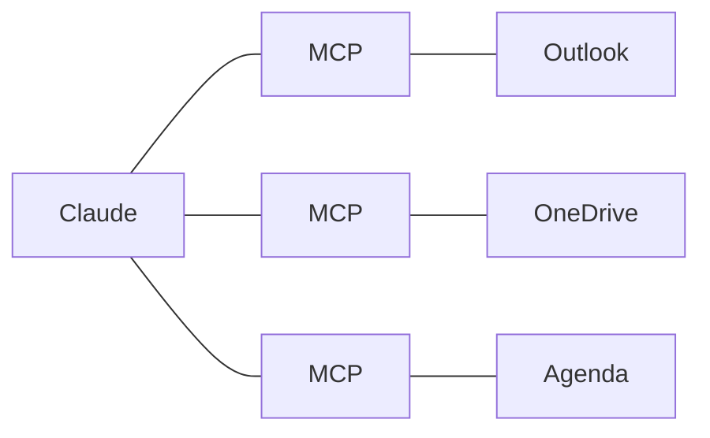

# 4 - IA générative et IA agentique

---
## 4. Comprendre ce qu'on vient de voir
L'IA générative: une IA qui **crée du contenu** (texte, image, son, vidéo, code), au lieu de seulement classer des données.

---
## Comment ça marche, sans maths
- Un LLM (grand modèle de langage) **prédit la suite la plus probable** d'un texte
- Il écrit morceau par morceau. Ces morceaux s'appellent des **tokens** (environ trois quarts d'un mot)
- Il a appris sur une énorme quantité de textes, jusqu'à une date limite
- Il ne "sait" rien de votre école, **sauf ce que vous lui donnez**

---
## Le prompt
Le prompt, c'est la demande que vous écrivez. C'est **une partie du contexte**, pas tout le contexte.

Un bon prompt dit:
1. Qui vous êtes
2. Ce que vous voulez
3. Pour qui
4. Sous quelle forme (longueur, ton, liste ou texte)
5. Un exemple, si vous en avez un

---
## L'hallucination
- Claude prédit ce qui est probable, **pas ce qui est vrai**
- Il peut donc inventer un fait, une date, une source, avec aplomb
- C'est une **hallucination**
- Règle: les faits, les chiffres et les sources **se vérifient toujours**

Une analogie: un stagiaire très cultivé, très rapide, qui ne vous connaît pas, et qui **n'ose jamais dire** "je ne sais pas".

---
## Points forts, points faibles
| Bon pour | Moins bon pour |
|---|---|
| Rédiger, reformuler | Les faits précis |
| Résumer, traduire | Les chiffres |
| Structurer, trier | Les sources |
| Trouver des idées | L'actualité, sans recherche web |

*À lire seul*

---
## L'IA agentique
Un chatbot répond. Un agent **agit**.

---
## La boucle d'un agent

1. Plan

2. Action (un outil)

3. Observation du résultat

4. On recommence, ou c'est fini

C'est ce qu'il a fait avec la circulaire: lire, trier, vérifier, faire le tableau.

Note: Laisser l'animation tourner une fois. Exemple parlé avec la circulaire: plan (lire les sections), action (lire le PDF), observation (des actions pour plusieurs niveaux), recommencer (trier, vérifier les dates), fini (le tableau).

---
## Les outils d'un agent
- La recherche web
- Les fichiers d'un dossier de votre ordinateur
- Le navigateur (Claude in Chrome)
- L'ordinateur lui-même: l'écran, la souris, le clavier
- Les connecteurs: Microsoft 365, Google Drive, etc.

---
## Les connecteurs et MCP
- MCP (Model Context Protocol) est une **prise standard** entre une IA et un autre outil
- Un connecteur, c'est un serveur MCP: il donne à l'IA l'accès à un outil (agenda, mails, fichiers)
- Le même standard marche pour Claude, ChatGPT et d'autres
- Chaque connecteur ajoute des possibilités, et aussi des risques: **n'activez que ce qui sert**

---
## Les skills
- Une skill, c'est **une façon de faire**, écrite une fois, que Claude suit chaque fois
- Exemples pour l'école
	- "Comment j'écris aux parents": le ton, la longueur, la signature
	- "Comment je trie une circulaire": ce qui concerne mon niveau, le format du tableau
- Claude charge une skill seulement quand il en a besoin
- On l'appelle avec "/", ou Claude la choisit seul

Pour un système qui vous connaît: les skills sont vos processus écrits. C'est le cœur d'un système qui vous connaît.

---
## L'humain reste dans la boucle
- Claude demande la permission avant les actions importantes
- Envoyer, supprimer, payer, publier: **c'est vous qui validez**
- Lisez la demande de permission avant de dire oui
