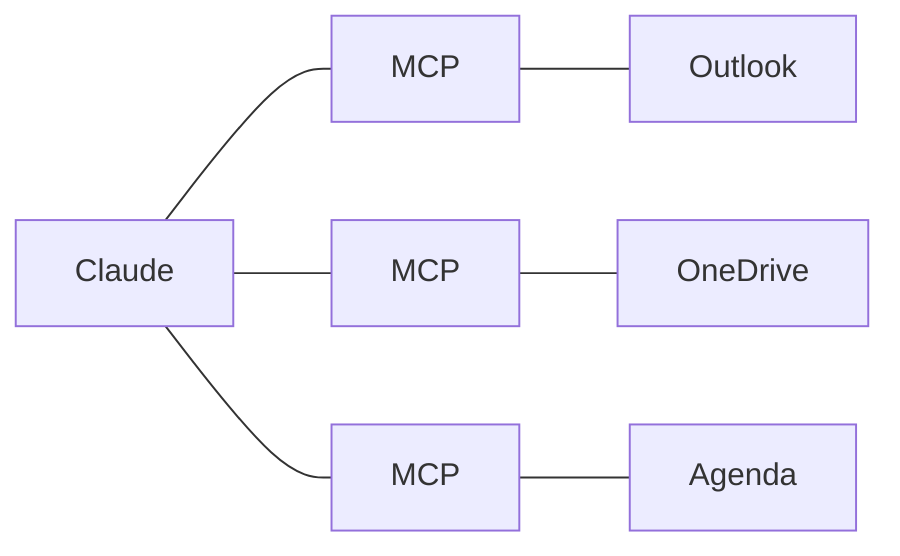

# 4 - IA générative et IA agentique

---
## 4. Comprendre ce qu'on vient de voir
L'IA générative: une IA qui **crée du contenu** (texte, image, son, vidéo, code), au lieu de seulement classer des données.

---
## Comment ça marche, sans maths
- Un LLM (grand modèle de langage) **prédit la suite la plus probable** d'un texte
- Il écrit morceau par morceau. Ces morceaux s'appellent des **tokens** (environ trois quarts d'un mot)
- Il a appris sur une énorme quantité de textes, jusqu'à une date limite
- Il ne "sait" rien de votre école, **sauf ce que vous lui donnez**

---
## Le prompt
Le prompt, c'est la demande que vous écrivez. C'est **une partie du contexte**, pas tout le contexte.

Un bon prompt dit:
1. Qui vous êtes
2. Ce que vous voulez
3. Pour qui
4. Sous quelle forme (longueur, ton, liste ou texte)
5. Un exemple, si vous en avez un

Astuce: demandez-lui de **vous poser des questions** avant de commencer: "Pose-moi les questions qui te manquent." Il propose souvent des choix à cliquer: c'est très rapide.

---
## L'hallucination
- Claude prédit ce qui est probable, **pas ce qui est vrai**
- Il peut donc inventer un fait, une date, une source, avec aplomb
- C'est une **hallucination**
- Règle: les faits, les chiffres et les sources **se vérifient toujours**

Une analogie: un stagiaire très cultivé, très rapide, qui ne vous connaît pas, et qui **n'ose jamais dire** "je ne sais pas".

---
## La complaisance
- Claude a tendance à **vous donner raison**: il flatte, il évite de vous contredire
- Il a appris à plaire, pas à dire la vérité qui dérange
- Le risque: il valide une mauvaise idée, un calcul faux, une décision fragile
- La parade: demandez-lui de **critiquer**. "Qu'est-ce qui cloche dans ce plan?", "Joue l'avocat du diable", "Donne-moi les trois meilleures objections"

Note: C'est le risque le plus utile à connaître pour une direction: on utilise Claude pour vérifier ses propres décisions, et il a tendance à les approuver. Le montrer en direct si le temps le permet: proposer une idée discutable, puis demander "Qu'est-ce qui cloche?".

---
## Points forts, points faibles
| Bon pour | Moins bon pour |
|---|---|
| Rédiger, reformuler | Les faits précis |
| Résumer, traduire | Les chiffres |
| Structurer, trier | Les sources |
| Trouver des idées | L'actualité, sans recherche web |

Attention: il peut être brillant sur une tâche et rater la tâche voisine. **Testez-le sur vos vraies tâches**, et plus d'une fois.

---
## Pas seulement du texte
- **Lire des images**: une photo d'une page écrite à la main, une capture d'écran, un tableau photographié deviennent du texte ou un tableau
- **Créer des visuels**: un schéma, une affiche simple, une infographie. Pour des images réalistes, d'autres outils existent (ChatGPT, Gemini)
- **Créer des animations et des vidéos courtes**, à partir d'un texte ou d'un tableau
- **Créer des petits jeux et des applications**: un quiz pour une classe, un jeu de calcul mental, un outil de tirage au sort, en quelques minutes

Note: Exemple à dire: "Crée un jeu de calcul mental pour des élèves de 2e primaire, avec un score." Claude le construit dans un artefact, et on peut y jouer tout de suite. Pour les animations: Claude Motion existe sur Team et Enterprise, mais il est désactivé par défaut sur Enterprise.

---
## L'IA agentique
Un chatbot répond. Un agent **agit**.

---
## Tout ce que vous faites sur votre PC, Claude peut le faire
Ce que vous pouvez faire sur votre ordinateur, dans le navigateur ou sur le réseau, un agent peut le faire aussi. **Avec votre accord.**

- **Fichiers**: lire, écrire, renommer, ranger un dossier entier
- **Documents**: créer des Word, des Excel, des PDF, des présentations
- **Web**: ouvrir des pages, les lire, chercher, remplir un formulaire
- **Messages**: préparer et envoyer des mails, lire un agenda (avec un connecteur)
- **Applications**: cliquer et taper dans une application, comme vous

La limite n'est plus ce que l'IA sait faire, mais **ce que vous lui permettez** de faire.

Note: Dire que c'est le grand changement de 2025-2026: on passe d'une IA qui répond à une IA qui fait. Donner un exemple de la matinée: la circulaire, Claude l'a lue et en a fait un tableau. Annoncer les démos de la partie 6 (fichiers, dossier, navigateur, présentation). Faire le lien avec la partie 8: plus un agent peut faire, plus il faut choisir ce qu'on lui permet.
---
## La boucle d'un agent

1. Plan

2. Action (un outil)

3. Observation du résultat

4. On recommence, ou c'est fini

C'est ce qu'il a fait avec la circulaire: lire, trier, vérifier, faire le tableau.

Note: Laisser l'animation tourner une fois. Exemple parlé avec la circulaire: plan (lire les sections), action (lire le PDF), observation (des actions pour plusieurs niveaux), recommencer (trier, vérifier les dates), fini (le tableau).

---
## Les connecteurs et MCP
- MCP (Model Context Protocol) est une **prise standard** entre une IA et un autre outil
- Un connecteur, c'est un serveur MCP: il donne à l'IA l'accès à un outil (agenda, mails, fichiers)
- Le même standard marche pour Claude, ChatGPT et d'autres
- Chaque connecteur ajoute des possibilités, et aussi des risques: **n'activez que ce qui sert**

---
## Les skills
- Une skill, c'est **une façon de faire**, écrite une fois, que Claude suit chaque fois
- Exemples pour l'école
	- "Comment j'écris aux parents": le ton, la longueur, la signature
	- "Comment je trie une circulaire": ce qui concerne mon niveau, le format du tableau
- Claude charge une skill seulement quand il en a besoin
- On l'appelle avec "/", ou Claude la choisit seul

Pour un système qui vous connaît: les skills sont vos processus écrits. C'est le cœur d'un système qui vous connaît.

---
## L'humain reste dans la boucle
- Claude demande la permission avant les actions importantes
- Envoyer, supprimer, payer, publier: **c'est vous qui validez**
- Lisez la demande de permission avant de dire oui
