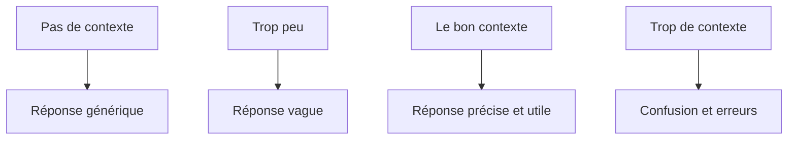
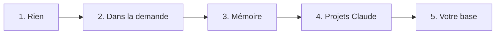

# 5 - Le contexte et sa gestion

---
## 5. Le contexte
Le contexte, c'est **tout ce que Claude voit** au moment de répondre.

- Vos instructions et votre prompt
- La conversation jusqu'ici
- Les documents joints
- Les résultats des outils (une page web, un fichier lu)
- Le reste, **il ne le connaît pas**

---
## La session
- Une session, c'est une conversation
- À chaque message, Claude **relit toute la conversation** depuis le début
- Entre deux conversations, **il ne se souvient de rien**
- Sauf ce qui est dans un projet Claude ou dans sa mémoire

---
## Plusieurs conversations en parallèle
- Vous pouvez donner **plusieurs tâches en même temps**: une conversation par tâche
- Par exemple: le tableau des sorties dans l'une, la circulaire dans une autre, un mail aux parents dans une troisième
- Chaque conversation **avance à son rythme**, et vous passez de l'une à l'autre
- Vous relisez et vous corrigez quand une tâche est prête

Note: Le montrer en direct: lancer une tâche longue (par exemple ranger le dossier), puis ouvrir une nouvelle conversation pour un mail court pendant que la première travaille. C'est aussi une bonne raison de faire des conversations courtes: une tâche, une conversation.

---
## La fenêtre de contexte
- C'est la quantité maximum de texte que Claude **lit en une fois**: tout ce qu'il a sous les yeux pendant la conversation
- Elle est grande: environ **un million de tokens**, soit plusieurs centaines de milliers de mots
- Mais elle n'est **pas infinie**, et tout y compte: vos messages, ses réponses, les documents, les pages lues
- Ce qui tient dans la fenêtre **n'est pas forcément bien lu**

---
## Quand ça devient moins fiable
- La fiabilité **baisse peu à peu** quand la conversation s'allonge, bien avant que la fenêtre soit pleine
- Ce qui est **au milieu** d'un long contexte est moins bien utilisé que le début et la fin
- Il n'y a **pas de seuil précis**: cela dépend de la tâche et du modèle. Repère pratique avec Opus 5.5 (fenêtre d'un million de tokens): **très fiable jusqu'à environ 500 000 à 600 000 tokens**
- Les signes: il **oublie une consigne**, il **se répète**, il **se contredit**, il **invente**. Alors: nouvelle conversation

Note: Sources: l'étude "Context Rot" de Chroma (2025): pour la même question, la qualité baisse quand le texte autour s'allonge; et "Lost in the Middle" (2023): le début et la fin d'un long texte sont mieux utilisés que le milieu. La phrase à retenir: la taille de la fenêtre dit combien de texte tient, pas comment il est lu.
---
## La fiabilité selon la longueur

<svg viewBox="0 0 960 330" xmlns="http://www.w3.org/2000/svg" role="img" aria-label="Schéma: la fiabilité baisse quand la conversation s'allonge">
<rect x="80" y="20" width="480" height="240" fill="rgba(74,222,128,0.13)"/><rect x="560" y="20" width="160" height="240" fill="rgba(251,191,36,0.15)"/><rect x="720" y="20" width="160" height="240" fill="rgba(255,20,147,0.15)"/>
<line x1="80" y1="260" x2="880" y2="260" stroke="rgba(255,255,255,0.55)" stroke-width="2"/><line x1="80" y1="20" x2="80" y2="260" stroke="rgba(255,255,255,0.55)" stroke-width="2"/>
<path d="M80,45 C300,47 460,52 560,64 C640,82 700,122 760,168 C810,205 850,226 880,236" fill="none" stroke="#ff1493" stroke-width="5" stroke-linecap="round"/>
<text x="320" y="200" fill="#4ade80" font-size="22" font-weight="700" text-anchor="middle">Zone confortable</text><text x="640" y="200" fill="#fbbf24" font-size="20" font-weight="700" text-anchor="middle">Prudence</text><text x="800" y="120" fill="#ff4fa8" font-size="20" font-weight="700" text-anchor="middle">Moins fiable</text>
<text x="80" y="288" fill="rgba(255,255,255,0.75)" font-size="17" text-anchor="middle">0</text><text x="280" y="288" fill="rgba(255,255,255,0.75)" font-size="17" text-anchor="middle">250 000</text><text x="480" y="288" fill="rgba(255,255,255,0.75)" font-size="17" text-anchor="middle">500 000</text><text x="680" y="288" fill="rgba(255,255,255,0.75)" font-size="17" text-anchor="middle">750 000</text><text x="880" y="288" fill="rgba(255,255,255,0.75)" font-size="17" text-anchor="middle">1 million</text>
<text x="480" y="318" fill="rgba(255,255,255,0.75)" font-size="17" text-anchor="middle">Taille du contexte (tokens)</text><text x="40" y="140" fill="rgba(255,255,255,0.75)" font-size="17" text-anchor="middle" transform="rotate(-90 40 140)">Fiabilité</text>
</svg>

Schéma indicatif, pas une mesure Repère pratique pour Opus 5.5: confortable jusqu'à environ 500 000 à 600 000 tokens.

Note: Ce schéma n'est pas un résultat de benchmark: Anthropic n'a pas publié de courbe de contexte long pour Opus 5.5. La forme (stable, puis une baisse) suit les études "Context Rot" de Chroma (2025, https://www.trychroma.com/research/context-rot) et "Lost in the Middle" (2023). Le repère de 500 000 à 600 000 tokens vient de l'expérience de Sébastien. Message: on n'approche presque jamais cette taille dans une conversation normale, mais une très longue conversation avec beaucoup de documents peut y arriver.
---
## Le cache
- Claude garde le début de la conversation pendant quelques minutes
- Il ne relit donc pas tout à chaque message: c'est plus rapide et moins cher
- Après une longue pause, il doit tout relire
- Conséquence: une très longue conversation reprise le lendemain **coûte plus et répond moins bien**

*À lire seul*

---
## Le coût d'une demande
- L'IA se paie en **tokens**: tout ce que Claude lit, plus tout ce qu'il écrit
- À chaque message, il **relit toute la conversation**: plus elle est longue, plus chaque message coûte
- Les documents joints et les pages web lues comptent aussi
- Un gros modèle (Opus) et un effort haut coûtent plus qu'un modèle plus léger (Sonnet) et un effort bas

Note: Ordre de grandeur pour la salle, sans chiffres précis: une question courte coûte très peu; une circulaire de 20 pages lue en effort haut coûte bien plus. Le message: ce n'est pas cher pour une vraie tâche, mais les longues conversations qui traînent coûtent sans rien rapporter.

---
## Budget et limites
- Avec Claude Entreprise, le collège paie un abonnement, et aussi **selon les tokens utilisés**
- Il peut y avoir **une limite par personne** ou un budget pour le collège: c'est l'admin qui les règle
- **Voir sa consommation**: l'application montre ce que vous avez utilisé et ce qui reste. Regardez-la de temps en temps
- Si une limite est atteinte, Claude le dit: attendre, ou demander à l'admin
- Les bons réflexes: **une conversation par sujet**, joindre seulement ce qui sert, Sonnet pour le simple, l'effort haut seulement quand il le faut

Note: Montrer en direct l'écran de l'utilisation dans l'application (dans les paramètres; le nom exact dépend de la version). À vérifier avec l'admin avant la séance: le contrat exact (abonnement seul, ou abonnement plus l'usage), les limites par personne, et où chacun voit sa consommation dans l'application. Si le contrat est un forfait sans usage, adapter la première ligne: "les tokens comptent dans votre quota".
---
## L'entonnoir du contexte

---
## Les types de contexte
1. Les instructions: ce que vous voulez, comment
2. Les exemples: un mot aux parents réussi
3. Les connaissances: le règlement, le calendrier
4. La mémoire: ce que Claude retient de vous
5. Les outils: ce que Claude peut aller chercher

*À lire seul*

---
## Cinq niveaux
1. Rien: on pose une question
2. Du contexte dans la demande: mieux, mais on se répète
3. La mémoire de Claude: il retient quelques éléments, de façon peu fiable
4. Les projets Claude: des instructions et des documents permanents
5. Une base de connaissances **à vous**, que l'IA utilise

---
## Les projets Claude
- Un projet Claude garde des instructions et des documents **pour toutes ses conversations**
- Exemple: un projet Claude "Direction primaire" avec le ton de l'école, le règlement, le calendrier
- Vous ne réexpliquez plus rien: chaque nouvelle conversation part de là
- Un projet Claude **par grand sujet**, pas un pour tout

---
## La limite des niveaux 3 et 4
- La mémoire et les projets Claude **vivent chez Anthropic**
- Ils ne passent pas dans un autre outil
- On voit mal ce qu'ils contiennent
- Chacun refait le sien, rien n'est partagé
- C'est un **contexte loué**

Mon conseil: **désactivez la mémoire de Claude**, et gardez ce qui doit durer dans votre fiche de contexte et vos projets Claude (voir le bonus 12).

---
## Plus n'est pas toujours mieux
- **Le contexte est fini**
- Chaque document ajouté rapporte un peu moins que le précédent
- Un document inutile peut même faire baisser la qualité
- Donnez **ce qui sert à la tâche**, pas tout ce que vous avez

---
## Une longue conversation se dégrade
- Claude se perd et mélange les sujets
- Il oublie des consignes du début
- Il **invente davantage**: les hallucinations augmentent
- Chaque message coûte plus, parce qu'il relit tout
- Ce n'est pas vous: c'est **la limite du contexte**

---
## Des conversations courtes, sur un seul point
**Évitez à tout prix les conversations longues et "fourre-tout".**

- Une conversation = **un point précis**: un mail, un tableau, une circulaire
- Dévier un peu, c'est permis. Changer de sujet: **nouvelle conversation**
- Besoin de garder la suite? Demandez **un résumé**, et collez-le dans une nouvelle conversation
- Mieux vaut **dix conversations courtes** qu'une seule longue

Note: C'est la règle la plus importante de la partie: la dire avec force. Les longues conversations sont la cause la plus fréquente des mauvaises réponses et des inventions.

---
## La compaction
- Quand une conversation devient trop longue, Claude **résume le début**
- Il continue à partir de ce résumé
- Les détails du début **peuvent se perdre**
- Si une consigne compte, redites-la, ou mettez-la dans votre fiche de contexte

Note: La compaction existe aussi dans l'application Claude (Claude Desktop). Montrer une longue conversation déjà compactée, préparée avant la séance. Image utile: un PV de réunion garde les décisions et perd les détails.

---
## Quatre règles pratiques
1. **Une conversation = un sujet**, et une conversation courte
2. Nouvelle conversation quand vous changez de sujet, ou quand les réponses se dégradent
3. Ce qui doit durer va **dans un fichier à vous** (la fiche de contexte) et dans un projet Claude
4. Pour garder la suite d'un travail, **demandez un résumé**, et repartez de ce résumé dans une nouvelle conversation

---
## L'idée centrale
**Résultat = modèle × contexte**

- Le modèle est le même pour vous trois: Claude Entreprise
- Le contexte, c'est vous qui le donnez
- C'est **le seul facteur que vous contrôlez**

Pour un système qui vous connaît: il choisit le bon contexte pour chaque demande, au lieu de tout mettre. Et ce contexte est à vous.

---
## Pause
10 minutes

Note: Pendant la pause, ouvrir les fichiers des démos et le dossier "Plan B - résultats attendus", au cas où.
