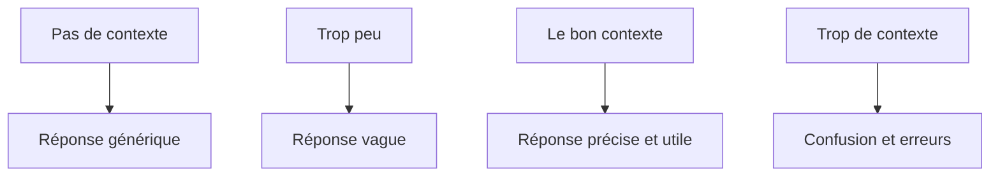
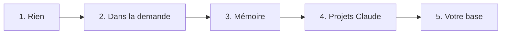

# 5 - Le contexte et sa gestion

---
## 5. Le contexte
Le contexte, c'est **tout ce que Claude voit** au moment de répondre.

---
## Ce que Claude voit
- Vos instructions et votre prompt
- La conversation jusqu'ici
- Les documents joints
- Les résultats des outils (une page web, un fichier lu)
- Le reste, **il ne le connaît pas**

Note: ESSENTIEL.

---
## La session
- Une session, c'est une conversation
- À chaque message, Claude **relit toute la conversation** depuis le début
- Entre deux conversations, **il ne se souvient de rien**
- Sauf ce qui est **écrit quelque part**: les fichiers de votre base de connaissances (ou un projet Claude, ou sa mémoire)
- Dans votre base, il ne relit pas tout: il lit **les fichiers qu'il va chercher** pour la tâche

Note: ESSENTIEL. Précision utile si la question vient: Claude ne charge pas toute la base à chaque conversation. Il cherche et il ouvre les fichiers dont il a besoin. D'où l'intérêt d'une base bien rangée, avec des noms clairs.

---
## Plusieurs conversations en parallèle
- Vous pouvez donner **plusieurs tâches en même temps**: une conversation par tâche
- Par exemple: le tableau des sorties dans l'une, la circulaire dans une autre, un mail aux parents dans une troisième
- Chaque conversation **avance à son rythme**, et vous passez de l'une à l'autre
- Vous relisez et vous corrigez quand une tâche est prête

Note: À PASSER si le temps manque. Le montrer en direct: lancer une tâche longue (par exemple ranger le dossier), puis ouvrir une nouvelle conversation pour un mail court pendant que la première travaille. C'est aussi une bonne raison de faire des conversations courtes: une tâche, une conversation.

---
## La fenêtre de contexte
- C'est la quantité maximum de texte que Claude **lit en une fois**: tout ce qu'il a sous les yeux pendant la conversation
- Elle est grande: environ **un million de tokens**, soit plusieurs centaines de milliers de mots
- Mais elle n'est **pas infinie**, et tout y compte: vos messages, ses réponses, les documents, les pages lues
- Ce qui tient dans la fenêtre **n'est pas forcément bien lu**

Note: ESSENTIEL.

---
## Plus c'est long, moins c'est fiable
- La fiabilité **baisse peu à peu** quand la conversation s'allonge, bien avant que la fenêtre soit pleine
- Ce qui est **au milieu** d'un long contexte est moins bien utilisé que le début et la fin
- **Plus n'est pas mieux**: chaque document ajouté rapporte un peu moins, et un document inutile peut faire baisser la qualité. Donnez **ce qui sert à la tâche**
- Les signes: il **oublie une consigne**, il **se répète**, il **mélange les sujets**, il **invente davantage**. Alors: nouvelle conversation
- Ce n'est pas vous: c'est **la limite du contexte**

Note: ESSENTIEL. Il n'y a pas de seuil précis: cela dépend de la tâche et du modèle. Repère pratique avec Opus 5.5 (fenêtre d'un million de tokens): très fiable jusqu'à environ 500 000 à 600 000 tokens. Ce repère vient de l'expérience de Sébastien, pas d'une mesure. On n'approche presque jamais cette taille dans une conversation normale, mais une très longue conversation avec beaucoup de documents peut y arriver. Sources: l'étude "Context Rot" de Chroma (2025, https://www.trychroma.com/research/context-rot): pour la même question, la qualité baisse quand le texte autour s'allonge; et "Lost in the Middle" (2023): le début et la fin d'un long texte sont mieux utilisés que le milieu. La phrase à retenir: la taille de la fenêtre dit combien de texte tient, pas comment il est lu.

---
## La fiabilité selon la longueur

<svg viewBox="0 0 960 330" xmlns="http://www.w3.org/2000/svg" role="img" aria-label="Schéma: la fiabilité baisse quand la conversation s'allonge">
<rect x="80" y="20" width="480" height="240" fill="rgba(74,222,128,0.13)"/><rect x="560" y="20" width="160" height="240" fill="rgba(251,191,36,0.15)"/><rect x="720" y="20" width="160" height="240" fill="rgba(255,20,147,0.15)"/>
<line x1="80" y1="260" x2="880" y2="260" stroke="rgba(255,255,255,0.55)" stroke-width="2"/><line x1="80" y1="20" x2="80" y2="260" stroke="rgba(255,255,255,0.55)" stroke-width="2"/>
<path d="M80,45 C300,47 460,52 560,64 C640,82 700,122 760,168 C810,205 850,226 880,236" fill="none" stroke="#ff1493" stroke-width="5" stroke-linecap="round"/>
<text x="320" y="200" fill="#4ade80" font-size="22" font-weight="700" text-anchor="middle">Zone confortable</text><text x="640" y="200" fill="#fbbf24" font-size="20" font-weight="700" text-anchor="middle">Prudence</text><text x="800" y="120" fill="#ff4fa8" font-size="20" font-weight="700" text-anchor="middle">Moins fiable</text>
<text x="80" y="288" fill="rgba(255,255,255,0.75)" font-size="17" text-anchor="middle">0</text><text x="280" y="288" fill="rgba(255,255,255,0.75)" font-size="17" text-anchor="middle">250 000</text><text x="480" y="288" fill="rgba(255,255,255,0.75)" font-size="17" text-anchor="middle">500 000</text><text x="680" y="288" fill="rgba(255,255,255,0.75)" font-size="17" text-anchor="middle">750 000</text><text x="880" y="288" fill="rgba(255,255,255,0.75)" font-size="17" text-anchor="middle">1 million</text>
<text x="480" y="318" fill="rgba(255,255,255,0.75)" font-size="17" text-anchor="middle">Taille du contexte (tokens)</text><text x="40" y="140" fill="rgba(255,255,255,0.75)" font-size="17" text-anchor="middle" transform="rotate(-90 40 140)">Fiabilité</text>
</svg>

Schéma indicatif, pas une mesure Stable longtemps, puis une baisse. Le seuil dépend de la tâche et du modèle.

Note: À PASSER si le temps manque. Ce schéma n'est pas un résultat de benchmark: Anthropic n'a pas publié de courbe de contexte long pour Opus 5.5. La forme (stable, puis une baisse) suit les études "Context Rot" de Chroma (2025) et "Lost in the Middle" (2023). Le repère de 500 000 à 600 000 tokens est dans les notes de la slide précédente.

---
## Le coût, en bref
- L'IA se paie en **tokens**: tout ce que Claude lit, plus tout ce qu'il écrit
- Avec Claude Entreprise, le collège paie **un siège par personne, plus l'usage**
- **Voir sa consommation**: dans les paramètres de l'application, la page de l'utilisation. Regardez-la de temps en temps
- Si une limite est atteinte, Claude s'arrête et le dit: **demander plus à l'admin**, ou attendre
- Premier levier: **le bon modèle pour la tâche**. Opus coûte 2 fois plus que Sonnet, et Fable 4 fois plus
- Deuxième levier: **des conversations courtes**. Claude relit tout à chaque message: une longue conversation coûte de plus en plus
- Le détail (les prix, les limites, le suivi): **bonus 18**

Note: À PASSER si le temps manque, sauf l'écran de l'utilisation: le montrer en direct (dans les paramètres; la documentation en anglais dit "Settings > Usage", le nom exact dépend de la version et de la langue). À vérifier avec l'admin avant la séance: le contrat exact (usage au volume, ou ancien contrat avec un quota inclus), les limites par personne, et si chacun voit bien sa consommation. Si le contrat est un ancien contrat avec quota, adapter la deuxième ligne: "les tokens comptent dans votre quota". Ordre de grandeur pour la salle, sans chiffres précis: une question courte coûte très peu; une circulaire de 20 pages lue en effort haut coûte bien plus.

---
## L'entonnoir du contexte

Note: À PASSER si le temps manque.

---
## Les types de contexte
1. Les instructions: ce que vous voulez, comment
2. Les exemples: un mot aux parents réussi
3. Les connaissances: le règlement, le calendrier
4. La mémoire: ce que Claude retient de vous
5. Les outils: ce que Claude peut aller chercher

Note: À PASSER si le temps manque.

---
## Cinq niveaux
1. Rien: on pose une question
2. Du contexte dans la demande: mieux, mais on se répète
3. La mémoire de Claude: il retient quelques éléments, de façon peu fiable
4. Les projets Claude: des instructions et des documents permanents
5. Une base de connaissances **à vous**, que l'IA utilise

Note: ESSENTIEL.

---
## Les projets Claude
- Un projet Claude garde des instructions et des documents **pour toutes ses conversations**
- Exemple: un projet Claude "Direction primaire" avec le ton de l'école, le règlement, le calendrier
- Pratique, mais tout reste **chez Anthropic**, et chaque projet est une île
- Mon conseil: **pas de projet Claude**, mais **un seul dossier de travail** pour l'IA: votre base de connaissances

Note: À PASSER si le temps manque: la slide suivante dit l'essentiel.

---
## La limite des niveaux 3 et 4
- La mémoire et les projets Claude **vivent chez Anthropic**
- Ils ne passent pas dans un autre outil
- On voit mal ce qu'ils contiennent
- Chacun refait le sien, rien n'est partagé
- C'est un **contexte loué**

La mémoire de Claude est **à proscrire**: elle ne vous appartient pas vraiment, elle est peu fiable, elle retient des choses un peu au hasard, et elle s'en sert un peu au hasard aussi. **Désactivez-la.**

Note: ESSENTIEL. C'est ici qu'on le dit avec force, une seule fois: la mémoire de Claude est à proscrire. Les autres parties y renvoient.

---
## Le niveau 5: votre base de connaissances
- Une **source de contexte** facile d'accès, pour vous et pour l'IA
- L'idéal: des **fichiers texte** (Markdown: du texte simple, avec # pour les titres), dans un dossier à vous
- Elle contient le contexte de **vos rôles, vos projets, vos personnes, vos processus**
- L'idéal: **démarrer chaque conversation dans le dossier** de votre base de connaissances
- Tout ce qui doit durer y va. **Une seule source de vérité**

Note: ESSENTIEL. C'est le fil rouge de la suite: la partie 7 montre à quoi ressemble cette base. Dans l'application Claude, "démarrer dans le dossier" = choisir ce dossier comme dossier de travail.

---
## Des conversations courtes, sur un seul point
**Évitez à tout prix les conversations longues et "fourre-tout".**

1. **Une conversation = un sujet**: un mail, un tableau, une circulaire. Mieux vaut **dix conversations courtes** qu'une seule longue
2. Nouvelle conversation quand vous **changez de sujet**, ou quand les réponses se dégradent
3. Ce qui doit durer va **dans votre base de connaissances**
4. Pour garder la suite d'un travail: **"Donne-moi un prompt que je peux passer à un autre agent pour continuer."{copy}** Collez-le dans une nouvelle conversation
5. N'attendez pas que Claude **résume lui-même** le début d'une conversation trop longue (la compaction): il perd beaucoup d'informations (bonus 18)

Note: ESSENTIEL. C'est la règle la plus importante de la partie: la dire avec force. Les longues conversations sont la cause la plus fréquente des mauvaises réponses et des inventions. Dévier un peu, c'est permis. Si le temps le permet, montrer une longue conversation déjà compactée, préparée avant la séance. Image utile: un PV de réunion garde les décisions et perd les détails.

---
## L'idée centrale
**Résultat = modèle × contexte**

- Le modèle est le même pour vous trois: Claude Entreprise
- Le contexte, c'est vous qui le donnez
- C'est **le seul facteur que vous contrôlez**

Pour un système qui vous connaît: il choisit le bon contexte pour chaque demande, au lieu de tout mettre. Et ce contexte est à vous.

Note: ESSENTIEL.

---
## Pause
10 minutes

Note: Pendant la pause, ouvrir les fichiers des démos et le dossier "Plan B - résultats attendus", au cas où.
