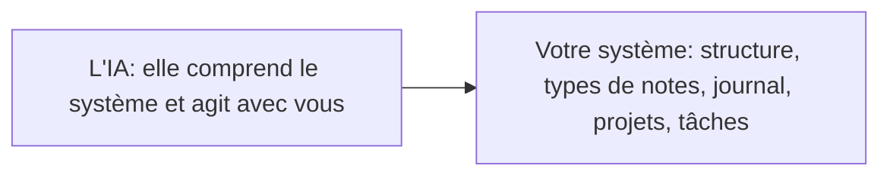
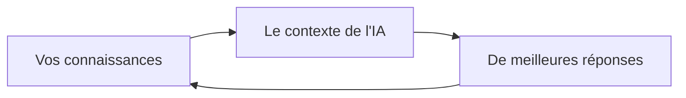

# 7 - Un système qui vous connaît

---
## 7. Un système qui vous connaît
Et qui vous appartient.

---
## Le constat
- La limite n'est plus l'IA
- La limite, c'est **ce qu'elle sait de vous**
- Chaque conversation **repart de zéro**, ou presque

Note: ESSENTIEL.

---
## Décharger son cerveau
- Tout ce que vous gardez en tête **vous pèse**: le car à confirmer, le parent à rappeler, le dossier à corriger
- Écrit dans un endroit fiable, ça ne vous pèse plus: **votre tête se libère**
- C'est votre **second cerveau digital**: d'abord pour vous, et en bonus pour l'IA
- **Double gain**: vous vous déchargez aujourd'hui, et chaque note rend l'IA plus utile demain

- Attention au revers: l'IA produit vite, et on peut **vite en faire trop**. Vous faites travailler l'IA, ou est-ce l'IA qui vous fait travailler?

Note: ESSENTIEL. Message clé: on ne note pas "pour l'IA". On note d'abord pour soi, pour se décharger. L'IA en profite en plus. Le plus simple pour commencer: tout noter dans le journal du jour, et ranger plus tard.

---
## L'habitude de noter
Les paroles s'envolent, les écrits restent.

- Noter **tout de suite**: une idée, une décision, un appel, une chose à faire
- Noter **ce qui compte**, pas tout
- Noter aussi **le contexte**: pourquoi, avec qui, et quelle est la suite
- Relire au moins **une fois par semaine**

Note: À PASSER si le temps manque. Exemple: un parent appelle pour la sortie P4. On note tout de suite ce qui est dit, ce qui est décidé et la suite. Les gens savent qu'on reviendra vers eux, parce que c'est écrit. Sans cette habitude, le reste ne marche pas: on ne peut ni ranger, ni relier, ni donner à l'IA ce qu'on n'a pas noté.

---
## Le journal du jour
Le plus simple pour commencer: **une seule note par jour**.

- Tout y va: les appels, les idées, les décisions, les choses à faire
- **Rien à décider** sur le moment: pas de titre, pas de dossier
- Une fois par semaine, **on range**: une tâche, un projet, une note sur une personne
- Pour l'IA, c'est **une mine d'or**: "Qu'est-ce que j'ai promis cette semaine?"{copy}, "Qu'est-ce qui est resté en suspens?"{copy}

Note: ESSENTIEL. Dans la démo Saint-Exemple, montrer la note du jour du 09/11. Avant la phase 2: un dossier "Journal" dans votre base de connaissances, avec un fichier texte par jour (2026-11-17.md).

---
## Capturer partout, une seule source de vérité
- Un système pour **toujours pouvoir capturer** une information ou une idée, vite: au bureau, sur le téléphone, en dictant
- Tout finit au même endroit: **votre base de connaissances**. Une seule source de vérité
- Plus de post-it, de mails à soi-même et de carnets dispersés
- **Organiser la base** est un objectif à très long terme: c'est **le cœur du système**. On commence simple, on range un peu chaque semaine

Note: À PASSER si le temps manque.

---
## Deux couches
- En bas: un système qui fonctionne pour vous, **même sans IA**. Une structure claire, des types de notes, un journal, des projets et des tâches
- Au-dessus: une IA qui **comprend tout ce système**, et qui travaille avec vous
- L'IA ne vaut que ce que vaut **la couche du dessous**
- **D'abord pour vous, en bonus pour l'IA**: c'est votre second cerveau digital, pas juste une base de connaissances au service de l'IA
- Ce sont des fichiers texte, chez vous: ils fonctionnent avec **n'importe quelle IA**. Obsidian sert à les lire et à les écrire

Note: ESSENTIEL.

---
## Ce qu'un système sait de vous
1. Qui vous êtes: votre rôle, votre école, vos valeurs, votre ton
2. Vos objectifs et vos projets: les priorités de l'année, les projets en cours, ce que vous attendez des autres
3. Votre environnement: les personnes, les outils (mAGEordome, GEDI-PRO, RAVEL, OneDrive, IT School), le calendrier scolaire
4. Vos processus: comment vous organisez une sortie, une inscription, la revue du lundi

Note: À PASSER si le temps manque.

---
## Une note, un type, une place

<svg viewBox="0 0 960 282" xmlns="http://www.w3.org/2000/svg" role="img" aria-label="Schéma: une note de type sortie, rangée à une seule place, avec ses propriétés et ses liens">
<rect x="40" y="12" width="150" height="44" rx="8" fill="#475363"/>
<text x="115" y="36" font-size="15" fill="#fff" font-weight="700" text-anchor="middle">Sorties</text>
<text x="204" y="36" font-size="14" fill="rgba(255,255,255,0.74)" font-weight="400" text-anchor="start">une seule place</text>
<rect x="40" y="44" width="430" height="226" rx="12" fill="#2b323c" stroke="rgba(255,255,255,0.45)" stroke-width="2"/>
<text x="62" y="82" font-size="20" fill="#fff" font-weight="700" text-anchor="start">Sortie P4 au musée</text>
<rect x="62" y="96" width="126" height="28" rx="14" fill="#e5007d"/>
<text x="125" y="115" font-size="13.5" fill="#fff" font-weight="700" text-anchor="middle">type: sortie</text>
<text x="200" y="115" font-size="14" fill="rgba(255,255,255,0.74)" font-weight="400" text-anchor="start">un seul type</text>
<text x="62" y="156" font-size="15" fill="rgba(255,255,255,0.74)" font-weight="400" text-anchor="start">date</text>
<text x="150" y="156" font-size="15" fill="#fff" font-weight="700" text-anchor="start">26 novembre 2026</text>
<text x="62" y="183" font-size="15" fill="rgba(255,255,255,0.74)" font-weight="400" text-anchor="start">classe</text>
<text x="150" y="183" font-size="15" fill="#fff" font-weight="700" text-anchor="start">P4</text>
<text x="62" y="210" font-size="15" fill="rgba(255,255,255,0.74)" font-weight="400" text-anchor="start">prix</text>
<text x="150" y="210" font-size="15" fill="#fff" font-weight="700" text-anchor="start">12 € par enfant</text>
<text x="62" y="237" font-size="15" fill="rgba(255,255,255,0.74)" font-weight="400" text-anchor="start">payé</text>
<text x="150" y="237" font-size="15" fill="#fbbf24" font-weight="700" text-anchor="start">non</text>
<text x="750" y="30" font-size="14" fill="#ff4fa8" font-weight="700" text-anchor="middle">LIÉE À</text>
<line x1="470" y1="157" x2="600" y2="71" stroke="#ff4fa8" stroke-width="2"/>
<rect x="600" y="50" width="300" height="42" rx="21" fill="#475363"/>
<text x="750" y="77" font-size="15" fill="#fff" font-weight="700" text-anchor="middle">La classe de P4</text>
<line x1="470" y1="157" x2="600" y2="139" stroke="#ff4fa8" stroke-width="2"/>
<rect x="600" y="118" width="300" height="42" rx="21" fill="#475363"/>
<text x="750" y="145" font-size="15" fill="#fff" font-weight="700" text-anchor="middle">Thibault Marchal, instituteur</text>
<line x1="470" y1="157" x2="600" y2="207" stroke="#ff4fa8" stroke-width="2"/>
<rect x="600" y="186" width="300" height="42" rx="21" fill="#475363"/>
<text x="750" y="213" font-size="15" fill="#fff" font-weight="700" text-anchor="middle">Le budget des sorties</text>
<text x="750" y="262" font-size="14" fill="rgba(255,255,255,0.74)" font-weight="400" text-anchor="middle">des liens, autant qu'on veut</text>
</svg>

- Le type dit **où la note est rangée** et **ce qu'elle contient**
- La liste "toutes les sorties de P4" **se fait toute seule**: pas besoin d'un dossier par classe

Note: À PASSER si le temps manque. Lien avec la démo 3: on a rangé des fichiers existants par classe. Pour des documents, c'est très bien, et la plupart ne doivent plus bouger. Dans le système, chaque sortie est une note de type "sortie" avec "classe: P4". On n'a plus à choisir un dossier: la liste par classe, par mois ou "pas encore payé" se fait toute seule. Et l'IA sait où chercher et ce qu'elle va trouver.

---
## Ce que l'IA lit d'abord
**La note de projet**, en une page:

<svg viewBox="0 0 960 316" xmlns="http://www.w3.org/2000/svg" role="img" aria-label="Schéma: une note de projet en une page, avec cinq rubriques numérotées">
<rect x="140" y="8" width="680" height="300" rx="10" fill="#f7f7f5"/>
<text x="170" y="42" font-size="18" fill="#1f2329" font-weight="700" text-anchor="start">Sortie P4 au musée des Sciences naturelles</text>
<text x="170" y="62" font-size="13" fill="#6b7480" font-weight="400" text-anchor="start">Note de projet</text>
<circle cx="182" cy="92" r="11" fill="#e5007d"/><text x="182" y="96.5" font-size="13" fill="#fff" font-weight="700" text-anchor="middle">1</text>
<text x="202" y="97" font-size="15" fill="#1f2329" font-weight="700" text-anchor="start">Ce que c'est, et pourquoi</text>
<text x="202" y="116" font-size="13.5" fill="#4b5563" font-weight="400" text-anchor="start">La visite du musée pour les 22 élèves de 4e primaire</text>
<circle cx="182" cy="136" r="11" fill="#e5007d"/><text x="182" y="140.5" font-size="13" fill="#fff" font-weight="700" text-anchor="middle">2</text>
<text x="202" y="141" font-size="15" fill="#1f2329" font-weight="700" text-anchor="start">Où on en est</text>
<text x="202" y="160" font-size="13.5" fill="#4b5563" font-weight="400" text-anchor="start">Statut: actif</text>
<circle cx="182" cy="180" r="11" fill="#e5007d"/><text x="182" y="184.5" font-size="13" fill="#fff" font-weight="700" text-anchor="middle">3</text>
<text x="202" y="185" font-size="15" fill="#1f2329" font-weight="700" text-anchor="start">La prochaine action</text>
<text x="202" y="204" font-size="13.5" fill="#4b5563" font-weight="400" text-anchor="start">Le mot aux parents avant le 12/11, puis le car avant le 13/11</text>
<circle cx="182" cy="224" r="11" fill="#e5007d"/><text x="182" y="228.5" font-size="13" fill="#fff" font-weight="700" text-anchor="middle">4</text>
<text x="202" y="229" font-size="15" fill="#1f2329" font-weight="700" text-anchor="start">Les décisions</text>
<text x="202" y="248" font-size="13.5" fill="#4b5563" font-weight="400" text-anchor="start">12 euros par enfant, à payer avant le 19/11</text>
<circle cx="182" cy="268" r="11" fill="#e5007d"/><text x="182" y="272.5" font-size="13" fill="#fff" font-weight="700" text-anchor="middle">5</text>
<text x="202" y="273" font-size="15" fill="#1f2329" font-weight="700" text-anchor="start">Les personnes et les documents</text>
<text x="202" y="292" font-size="13.5" fill="#4b5563" font-weight="400" text-anchor="start">Thibault Marchal, instituteur · le devis du car</text>
</svg>

Pour l'IA, ce sont des informations à lire, **pas un texte à deviner**.

Note: À PASSER si le temps manque.

---
## Démo: en vrac ou organisé
Les mêmes faits, dans deux dossiers:

- **En vrac**: des fichiers texte, comme on les note souvent
- **Organisé**: des notes de projet, avec un statut et des tâches datées
- La même question aux deux: "Liste mes projets en cours, avec leur statut et leur prochaine action. Lequel est bloqué?"{copy}

Note: ESSENTIEL. DÉMO EN VRAC OU ORGANISÉ (5 min), à l'écran. Dézipper avant la séance "Système Direction Saint-Exemple en vrac (démo).zip" et "Système Direction Saint-Exemple - notes seules (démo).zip".
1. Ouvrir Claude sur le dossier en vrac. Poser la question.
2. Ouvrir Claude sur le dossier organisé. Poser la même question.
3. Montrer dans la réponse du vrac la phrase où Claude dit qu'il a déduit les statuts lui-même, et les tâches qu'il compte comme des projets (les bancs, la photocopieuse).
4. Poser la question une deuxième fois au vrac: la liste change (au test du 05/11: 5 "projets", puis 6). L'organisé donne trois projets en cours et un terminé, avec les statuts lus dans les notes.
Message: en vrac, l'IA devine bien, mais elle devine. Organisé, elle sait. Ne pas promettre qu'elle se trompe sur le vrac: avec un bon modèle, elle trouve souvent le bon projet bloqué.
Corrigé: Sortie P4 (actif; mot aux parents avant le 12/11, puis car avant le 13/11). Plan de pilotage (actif; formations avant le 15/12). Classes de neige P5 (en pause, donc bloqué: 690 euros dépassent le plafond de 485 euros pour les six années; on attend la décision du PO, relance le 16/11). Pas en cours: les photos de classe (terminé le 23/10).
Pièges du vrac: "c'est réglé" pour les photos caché dans le journal; "réserver le photographe" encore dans "à faire.txt"; quatre projets de l'an passé listés "en cours" dans "Projets 2025-2026.txt"; le mot aux parents en double; les bancs sont une relance, pas un projet.
Le corrigé complet est la question 6 de "DEMO - À demander.txt".

---
## Avant et après
La sortie de P4 au musée, le 26 novembre.

<svg viewBox="0 0 960 258" xmlns="http://www.w3.org/2000/svg" role="img" aria-label="Schéma: sans système, dix lignes de contexte à chaque demande; avec un système, une seule ligne">
<text x="230" y="24" font-size="15" fill="#fbbf24" font-weight="700" text-anchor="middle">SANS SYSTÈME</text>
<rect x="30" y="38" width="400" height="184" rx="14" fill="#475363"/>
<rect x="50" y="56" width="340" height="9" rx="4" fill="rgba(255,255,255,0.38)"/>
<rect x="50" y="74" width="360" height="9" rx="4" fill="rgba(255,255,255,0.38)"/>
<rect x="50" y="92" width="300" height="9" rx="4" fill="rgba(255,255,255,0.38)"/>
<rect x="50" y="110" width="350" height="9" rx="4" fill="rgba(255,255,255,0.38)"/>
<rect x="50" y="128" width="330" height="9" rx="4" fill="rgba(255,255,255,0.38)"/>
<rect x="50" y="146" width="360" height="9" rx="4" fill="rgba(255,255,255,0.38)"/>
<rect x="50" y="164" width="280" height="9" rx="4" fill="rgba(255,255,255,0.38)"/>
<rect x="50" y="182" width="345" height="9" rx="4" fill="rgba(255,255,255,0.38)"/>
<rect x="50" y="200" width="220" height="9" rx="4" fill="rgba(255,255,255,0.38)"/>
<text x="230" y="246" font-size="14.5" fill="rgba(255,255,255,0.74)" font-weight="400" text-anchor="middle">dix lignes de contexte, à chaque demande</text>
<polygon points="0,0 12,0 26,16 12,32 0,32 14,16" transform="translate(462,112) scale(1.0)" fill="#e5007d"/>
<text x="730" y="24" font-size="15" fill="#4ade80" font-weight="700" text-anchor="middle">AVEC UN SYSTÈME</text>
<rect x="520" y="38" width="420" height="46" rx="14" fill="#e5007d"/>
<text x="730" y="67" font-size="16.5" fill="#fff" font-weight="700" text-anchor="middle">Prépare la sortie P4 du 26 novembre</text>
<text x="730" y="114" font-size="14.5" fill="rgba(255,255,255,0.74)" font-weight="400" text-anchor="middle">Il connaît déjà:</text>
<rect x="528" y="126" width="112" height="32" rx="16" fill="#475363"/>
<text x="584.0" y="147" font-size="14" fill="#fff" font-weight="700" text-anchor="middle">la classe</text>
<rect x="650" y="126" width="130" height="32" rx="16" fill="#475363"/>
<text x="715.0" y="147" font-size="14" fill="#fff" font-weight="700" text-anchor="middle">l'instituteur</text>
<rect x="790" y="126" width="142" height="32" rx="16" fill="#475363"/>
<text x="861.0" y="147" font-size="14" fill="#fff" font-weight="700" text-anchor="middle">le budget</text>
<rect x="545" y="166" width="190" height="32" rx="16" fill="#475363"/>
<text x="640.0" y="187" font-size="14" fill="#fff" font-weight="700" text-anchor="middle">le plafond des frais</text>
<rect x="745" y="166" width="170" height="32" rx="16" fill="#475363"/>
<text x="830.0" y="187" font-size="14" fill="#fff" font-weight="700" text-anchor="middle">le modèle de mot</text>
<text x="730" y="246" font-size="14.5" fill="rgba(255,255,255,0.74)" font-weight="400" text-anchor="middle">et il ajoute l'encodage sur IT School à vos tâches</text>
</svg>

Avec un système, la demande tient en une ligne: "Prépare la sortie P4 du 26 novembre"{copy}

Note: ESSENTIEL.

---
## Quatre façons de travailler
| | Le chat seul | Un projet Claude | La mémoire de Claude | Votre base |
|---|---|---|---|---|
| Ce qu'il sait de vous | Rien | Ce que vous y avez mis | Quelques éléments, peu visibles | **Tout ce qui compte, rangé** |
| Où c'est gardé | Chez Anthropic | Chez Anthropic | Chez Anthropic | **Chez vous** |
| Si vous changez d'IA | Rien à perdre | Tout à refaire | Perdu | **Rien à refaire** |
| Partagé avec l'équipe | Non | Un peu | Non | **Oui, si vous voulez** |

Note: À PASSER si le temps manque.

---
## Souverain: ce que ça veut dire
1. **Ne pas dépendre** de Claude seul, ni de ses projets, ni de sa mémoire
2. Une base de connaissances **à vous**: des fichiers texte, sur votre PC ou votre OneDrive, lisibles sans aucun outil
3. **Personnelle et partagée**: chaque direction a la sienne, et une partie commune peut servir à toute l'école
4. **Libre de changer de fournisseur**: la même base sert avec Claude aujourd'hui, et avec un autre demain
5. **Vous décidez** ce que l'IA voit, dossier par dossier
6. **Des fichiers, plutôt que des artefacts**: un artefact reste chez Anthropic. Ce qui doit durer devient un fichier, chez vous

Note: ESSENTIEL.

---
## Sauvegardez votre base
- Votre base de connaissances devient **précieuse**: des années de travail
- **Au moins deux copies**, dont une hors de votre PC (un disque externe, un autre cloud)
- La synchronisation n'est pas une sauvegarde: une erreur ou une suppression se synchronise aussi
- Avant de laisser un agent travailler seul dans la base: **une sauvegarde récente**
- Testez de temps en temps: **savez-vous restaurer** un fichier?

Note: À PASSER si le temps manque.

---
## Ce qu'il faut savoir
- Le modèle reste un **service externe**
- Chaque demande passe chez le fournisseur choisi
- Ce qui ne dépend plus de lui: vos connaissances, votre organisation, vos processus
- Si demain un autre modèle est meilleur, ou européen, ou local, vous changez **sans rien perdre**

Note: À PASSER si le temps manque.

---
## Louer ou posséder

<svg viewBox="0 0 960 284" xmlns="http://www.w3.org/2000/svg" role="img" aria-label="Schéma: un meublé loué chez Anthropic, ou une maison à vous, votre base de connaissances">
<polygon points="80,112 230,36 380,112" fill="none" stroke="rgba(255,255,255,0.65)" stroke-width="3" stroke-dasharray="9 7"/>
<rect x="96" y="112" width="268" height="124" rx="0" fill="none" stroke="rgba(255,255,255,0.65)" stroke-width="3" stroke-dasharray="9 7"/>
<text x="230" y="96" font-size="14.5" fill="#a855f7" font-weight="700" text-anchor="middle">chez Anthropic</text>
<text x="230" y="150" font-size="21" fill="#fff" font-weight="700" text-anchor="middle">Un meublé loué</text>
<text x="230" y="180" font-size="15.5" fill="rgba(255,255,255,0.74)" font-weight="400" text-anchor="middle">les projets Claude</text>
<text x="230" y="203" font-size="15.5" fill="rgba(255,255,255,0.74)" font-weight="400" text-anchor="middle">la mémoire de Claude</text>
<text x="230" y="268" font-size="15.5" fill="#fbbf24" font-weight="700" text-anchor="middle">Pratique, mais rien n'est à vous.</text>
<text x="480" y="172" font-size="22" fill="rgba(255,255,255,0.74)" font-weight="400" text-anchor="middle">ou</text>
<polygon points="580,112 730,36 880,112" fill="#e5007d"/>
<rect x="596" y="112" width="268" height="124" rx="0" fill="#e5007d"/>
<text x="730" y="96" font-size="14.5" fill="#fff" font-weight="700" text-anchor="middle">chez vous</text>
<text x="730" y="150" font-size="21" fill="#fff" font-weight="700" text-anchor="middle">Une maison à vous</text>
<text x="730" y="180" font-size="15.5" fill="#fff" font-weight="400" text-anchor="middle">votre base de connaissances</text>
<text x="730" y="203" font-size="15.5" fill="#fff" font-weight="400" text-anchor="middle">des fichiers texte, sur votre PC</text>
<text x="730" y="268" font-size="15.5" fill="#ff4fa8" font-weight="700" text-anchor="middle">Meublée une fois, et vous la gardez.</text>
</svg>

Note: ESSENTIEL.

---
## Démo: Direction Saint-Exemple
Un système construit sur AI Kit for Obsidian, avec une direction fictive.

- Les mêmes demandes que tout à l'heure, **en une ligne**
- Puis la même question dans un chat vide, pour comparer

Note: ESSENTIEL. DÉMO SYSTÈME (5 min), à l'écran. Ouvrir le dossier "Système Direction Saint-Exemple - notes seules (démo)" (dézippé avant la séance) dans Obsidian, et Claude sur ce dossier. Les demandes et les réponses attendues sont dans "DEMO - À demander.txt", à la racine du système. Pour chaque demande, montrer la réponse, puis poser la même question dans un chat vide. Les cinq demandes: 1) "Prépare la sortie P4 du 26 novembre." 2) "Fais ma revue du lundi." 3) "Écris aux parents de P4 que le paiement est attendu avant le 19/11." 4) "Qu'est-ce que j'attends des autres, et qui dois-je relancer cette semaine?" 5) "Quelles actions de la circulaire 9847 touchent mes projets?" (joindre le PDF). En 5 minutes: faire 1 et 2. Les autres si le temps le permet. Le fichier finit par un tableau qui compare le chat, un projet Claude, la mémoire de Claude et ce système. Si le temps le permet, 2 minutes dans mon propre système: le genre de demandes que je lui fais chaque jour.

---
## Démo: créer une skill ensemble
Notre première recette: **écrire aux parents**. Le processus est déjà écrit dans la base: la skill **le lit**.

> Aide-moi à créer une skill pour écrire les mots aux parents de mon école, en respectant la spécification des skills IA: https://agentskills.io/specification.md. La skill ne recopie pas mon processus: elle lit d'abord la note "Écrire aux parents (Processus)" de ma base de connaissances, puis elle la suit. Enregistre la skill dans le dossier "Skills" de ma base de connaissances.

Puis on la teste: "Écris le mot aux parents pour la sortie P4 du 26 novembre."{copy}

Ensuite, on change **une ligne du processus**, et on relance: le mot change, sans toucher à la skill.

Note: ESSENTIEL. DÉMO SKILL (5 min), à l'écran, Claude ouvert sur une copie du dossier "Direction Saint-Exemple" (le système de démo). 1) Coller la demande. 2) Montrer le résultat: un dossier "ecrire-aux-parents" avec un fichier SKILL.md (name, description, puis l'instruction de lire la note du processus). 3) Tester avec la sortie P4, dans une nouvelle conversation. 4) Ouvrir la note "Écrire aux parents (Processus)" (dossier Actions/Processus), changer "150 mots maximum" en "80 mots maximum", et enregistrer. 5) Nouvelle conversation, même demande: le mot est plus court. Message: on a changé le processus, pas la skill (bonus 14, "Le processus et la skill: deux choses"). Si quelque chose ne va pas: corriger le texte, pas la réponse. La skill vit dans le dossier de travail (la base de connaissances): rien à installer dans l'application. Pour s'en servir, Claude ouvert sur ce dossier: "Utilise la skill ecrire-aux-parents pour...". La spécification vient de agentskills.io, un format ouvert que d'autres outils IA lisent aussi.

---
## Une skill bien construite
Toujours **selon la spécification** (https://agentskills.io/specification.md):

- **Un dossier** au nom de la skill, en minuscules et avec des tirets: `ecrire-aux-parents`
- Dedans, **un fichier SKILL.md**: en haut, le **nom** et une **description** (ce qu'elle fait, et quand l'utiliser)
- Puis **les instructions**: les étapes, les règles, un exemple, les critères
- Si besoin, des dossiers à côté: des documents de référence, des modèles
- Court: **moins de 500 lignes**. Le détail va dans les documents de référence

Note: À PASSER si le temps manque.

---
## Avec votre système, une phrase suffit
- Le système de la phase 2 **connaît déjà la spécification** et l'endroit où ranger vos skills
- Vous dites simplement: **"Crée-moi une skill pour..."**
- Ou, après une conversation réussie: **"skillify"**. Il transforme ce que vous venez de faire en skill
- Vos recettes s'accumulent dans **votre base de connaissances**: elles vous appartiennent

Note: À PASSER si le temps manque.

---
## L'IA qui prend l'initiative
- Aujourd'hui: vous allez vers l'IA, et vous lui réexpliquez tout
- Demain: l'IA connaît vos projets, vos tâches et vos priorités, et **elle propose**
- Exemple, la revue du lundi: "Deux dossiers GEDI-PRO à corriger, la déclaration des classes de neige avant le 23 janvier, la sortie P4 pas encore payée. Je prépare le rappel aux parents?"
- **Elle propose, vous décidez**

Note: À PASSER si le temps manque.

---
## Le cercle vertueux

Vos notes deviennent le contexte de l'IA. Ses réponses deviennent de nouvelles notes.

Note: À PASSER si le temps manque.

---
## Le chemin
1. **La clarté**: votre rôle, vos priorités, vos objectifs (la fiche de contexte sert de point de départ)
2. **Le système**: votre base de connaissances, un endroit fiable et sauvegardé
3. **L'habitude de noter**: d'abord le journal du jour
4. **Les projets et les tâches**
5. Le reste, une étape à la fois

Les objectifs viennent d'en haut. Ce que vous notez chaque jour vient d'en bas. Les deux se rejoignent pendant les revues.

La phase 2: un système de base pour chacun, construit ensemble, à ce rythme.

Note: ESSENTIEL. D'abord une carte du dossier OneDrive, sans rien déplacer. La nouvelle information entre dans le système, les anciens dossiers suivent quand on travaille dessus.
